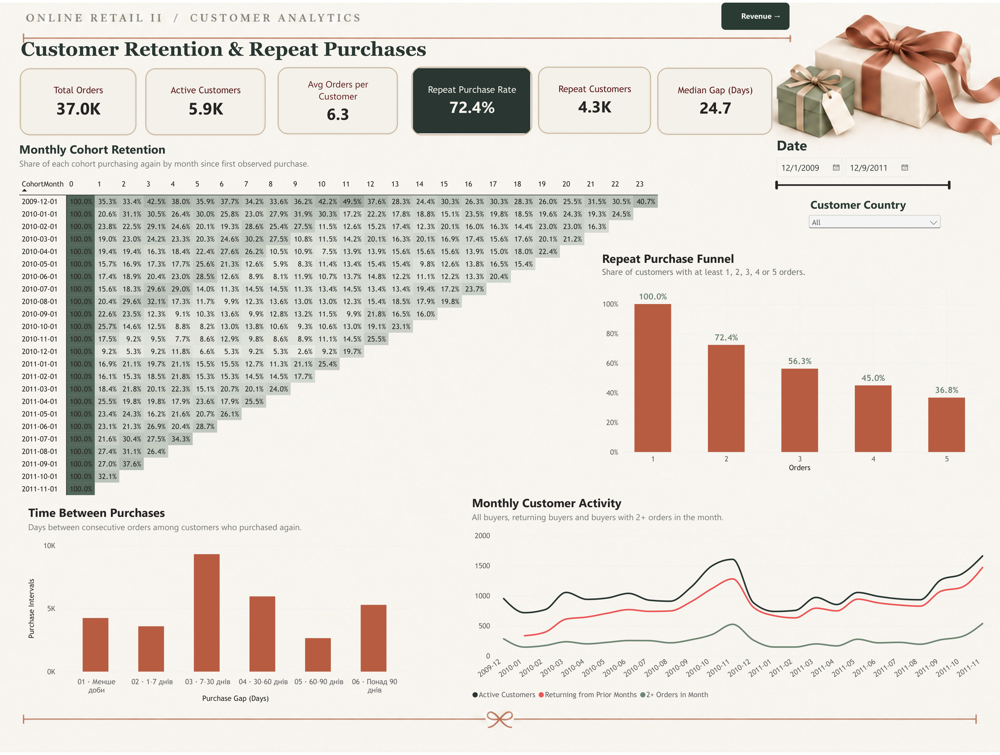

# Online Retail II — Customer Retention, Revenue & RFM

**Power BI · Power Query · DAX · Cohort Analysis · RFM Segmentation**

[Українська](#українська) · [English](#english)

## Українська

### Опис

Аналіз повторних покупок, утримання клієнтів і структури доходу британського інтернет-магазину подарункових товарів. Проєкт поєднує когортний аналіз із RFM-сегментацією та показує, як різні групи клієнтів формують дохід.

**Джерело:** [Online Retail II — UCI Machine Learning Repository](https://archive.ics.uci.edu/dataset/502/online+retail+ii). **Період:** 01.12.2009–09.12.2011. **Валюта:** GBP (£).

### Дашборд

[Відкрити інтерактивний дашборд у Power BI](https://app.powerbi.com/view?r=eyJrIjoiMzRkNjExMzEtZTZlMi00Yzc0LTk1YWMtYTI1YzkwMGFmMjQ5IiwidCI6ImE2ZjU2MzQ1LTU0YzctNDM0YS04YjQ5LWExNjdiMThlYmIzZSJ9)

> Дашборд опубліковано під час пробного періоду Microsoft Fabric / Power BI. Після завершення trial посилання може бути недоступним. [PDF-версія](report/Online_Retail_II_Retention.pdf) та зображення сторінок залишаються в репозиторії.

### Завдання

- Підготувати транзакції та розділити валідні покупки й операції, що зменшують дохід.
- Дослідити повторні покупки, місячний когортний retention та інтервали між замовленнями.
- Розрахувати Net Revenue, AOV, ARPU та внесок перших і повторних замовлень.
- Сегментувати клієнтів за RFM і порівняти частки клієнтів та доходу.
- Перевірити якість даних і пояснити розбіжності між фінансовою та клієнтською базами.

### Інструменти та реалізація

**Power Query:** об’єднання річних джерел, очищення, перевірка перекриття, формування таблиць покупок, замовлень і доходу. **DAX:** метрики, когортні розрахунки, послідовність покупок, RFM-бали та сегменти. **Power BI:** модель даних і дві інтерактивні сторінки зі зрізами дат та країни клієнта.

Основні таблиці: `Customers` — один рядок на клієнта з валідною покупкою; `Orders` — один рядок на комбінацію клієнта та інвойсу; `Revenue` — товарні транзакції, включно з поверненнями; `Calendar` — календар. `Audit_Duplicates` використовується для перевірки повторень. Довідники фільтрують факт-таблиці через зв’язки «один до багатьох».

### Сторінки звіту

**Customer Retention & Repeat Purchases:** місячний когортний retention, активні та повторні покупці, частки клієнтів із 1–5+ замовленнями, розподіл інтервалів між покупками.

**Customer Revenue & Purchase Value:** місячний Net Revenue та ARPU, AOV, дохід від перших і повторних замовлень, частки клієнтів і доходу за RFM-сегментами.

### Результати

| Показник | Значення |
|---|---:|
| Валідні замовлення | 36 969 |
| Клієнти з валідними покупками | 5 878 |
| Repeat Purchase Rate | 72,4% |
| Медіанний інтервал між послідовними покупками | 24,7 дня |
| Gross Revenue | £17 431 551,18 |
| Net Revenue | £16 343 669,04 |
| Сума повернень / Gross Revenue | 6,24% |
| AOV | £471,52 |
| ARPU | £2 780,48 |
| Дохід повторних замовлень / Gross Revenue | 91,76% |

- Повторні замовлення формують **91,76% доходу від покупок**. Це частка доходу, а не частка клієнтів.
- **Champions — 21,6% клієнтів і 69,4% чистого доходу сегментованої бази.** Концентрація частково очікувана: Monetary входить до правила сегмента.
- **At Risk — 474 клієнти**, які дали £1 283 685,77 чистого доходу, але мають відносно давню останню покупку. Це група для подальшого дослідження, а не підтверджений відтік.
- Великобританія формує приблизно **90,7% замовлень і 83,2% Net Revenue**; загальні результати переважно відображають її клієнтів.
- Перед кінцем року спостерігається підвищення активності. Зв’язок із різдвяним попитом — гіпотеза; двох років недостатньо для впевненого висновку про стійку сезонність.

### Методологія та якість даних

**Покупки й дохід.** Записи без Customer ID виключені. Валідна покупка: Quantity > 0, Price > 0 та інвойс без префікса C. Повернення не рахуються як покупки, але зменшують Net Revenue. AOV = Gross Revenue / кількість валідних замовлень; ARPU = Net Revenue / кількість активних покупців.

**Когорти.** Когорта визначається місяцем першої спостережуваної покупки. Retention — частка початкової когорти, що купувала в конкретному наступному місяці; клієнт може пропустити місяць і повернутися. Неповний грудень 2011 року виключений із когортної матриці та місячної активності. Медіана інтервалів враховує лише завершені проміжки між замовленнями.

**Перекриття джерел.** Виявлено повторне включення 1–9 грудня 2010 року. Перекриття усунено на рівні джерел: перша таблиця обмежена датами до 01.12.2010, друга завантажена повністю. Потенційні повторення товарних рядків усередині джерел залишені через відсутність унікального ідентифікатора позиції. Їхній можливий додатковий Net Revenue — £53 677,75 (приблизно 0,33%); це оцінка чутливості, а не доведена помилка.

**RFM.** Фіксований стан на **10.12.2011**: Recency — дні від останньої валідної покупки; Frequency — кількість валідних замовлень; Monetary — чистий дохід за всю історію. Для клієнтів із Monetary > 0 використано 20-й, 40-й, 60-й і 80-й процентилі. Менша Recency дає вищий R Score, більші Frequency та Monetary — вищі F і M. Однакові значення мають однакові бали, тому групи не обов’язково рівні. 41 клієнт із Monetary ≤ 0 виділений окремо. Зріз країни змінює склад і частки, але не глобальні бали; зріз дат не змінює фіксований RFM-стан.

Правила застосовуються зверху вниз, до першого збігу:

| Сегмент | Правило |
|---|---|
| Non-positive Net Revenue | Monetary ≤ 0 |
| Champions | R ≥ 4, F ≥ 4, M ≥ 4 |
| At Risk | R ≤ 2 та (F ≥ 4 або M ≥ 4) |
| Less Recent Customers | R ≤ 2 серед решти |
| Loyal Customers | F ≥ 4 серед решти |
| Recent Occasional Buyers | R ≥ 4 та F ≤ 2 серед решти |
| Other Customers | Решта клієнтів |

**Звірка доходу.** Дохід сегментованих клієнтів (£16 404 718,71) відрізняється від загального Net Revenue (£16 343 669,04). Різницю **−£61 049,67** повністю пояснює сума транзакцій із заповненим ID, для якого немає відповідного клієнта в `Customers`. Це не початкові null ID: таблиця клієнтів сформована з валідних покупок, а таблиця доходу має ширші правила включення. Ці транзакції залишені у фінансовому підсумку та не включені в RFM. Склад усіх таких операцій окремо не встановлений.

### Обмеження

Перша спостережувана покупка не обов’язково є першою покупкою клієнта взагалі. Нові клієнти мають менше часу для повторних замовлень; Frequency та Monetary залежать від тривалості спостереження. Країна визначена за першою валідною покупкою. Дані включають оптовиків і не репрезентують увесь ринок. Витрати відсутні, тому дохід не є прибутком, а прогнозний LTV не розрахований. Шестимісячний когортний дохід на клієнта збережений у моделі, але його графік замінено RFM-порівнянням.

### Файли

- [Power BI файл](report/Online_Retail_II_Retention.pbix)
- [PDF звіту](report/Online_Retail_II_Retention.pdf)
- [Детальний опис українською](docs/Online_Retail_II_Project_Description_UA.docx)
- `images/` — зображення двох сторінок.

Для перегляду локальної моделі відкрийте PBIX у Power BI Desktop. Для оновлення даних може знадобитися завантаження джерела UCI та зміна локальних шляхів у Power Query.

## English

### Overview

Customer retention, repeat purchasing and revenue analysis for a UK online gift retailer. The project combines cohort analysis with RFM segmentation to examine how customer groups contribute to observed revenue.

**Source:** [Online Retail II — UCI Machine Learning Repository](https://archive.ics.uci.edu/dataset/502/online+retail+ii). **Period:** 1 Dec 2009–9 Dec 2011. **Currency:** GBP (£).

### Dashboard

[Open the interactive Power BI dashboard](https://app.powerbi.com/view?r=eyJrIjoiMzRkNjExMzEtZTZlMi00Yzc0LTk1YWMtYTI1YzkwMGFmMjQ5IiwidCI6ImE2ZjU2MzQ1LTU0YzctNDM0YS04YjQ5LWExNjdiMThlYmIzZSJ9)

> Published during a Microsoft Fabric / Power BI trial. The link may become unavailable after the trial ends. A [PDF version](report/Online_Retail_II_Retention.pdf) and page previews remain available in this repository.

### Objectives

- Prepare transactions and distinguish valid purchases from revenue-reducing operations.
- Explore repeat purchases, monthly cohort retention and time between orders.
- Calculate Net Revenue, AOV, ARPU and first versus repeat order sales.
- Build RFM segments and compare their customer and revenue shares.
- Audit data quality and reconcile financial totals with the segmented customer base.

### Tools and implementation

**Power Query:** source consolidation, cleaning, overlap checks and purchase/order/revenue tables. **DAX:** metrics, cohort calculations, order sequencing, RFM scores and segments. **Power BI:** data modelling and two interactive report pages with date and customer-country filters.

`Customers` contains one row per customer with a valid purchase; `Orders` one row per customer/invoice combination; `Revenue` product-level transactions including returns; `Calendar` date attributes. `Audit_Duplicates` supports duplicate sensitivity checks. Dimensions filter fact tables through one-to-many relationships.

### Report pages

**Customer Retention & Repeat Purchases:** monthly cohort retention, customer activity, repeat purchase depth and intervals between consecutive orders.

**Customer Revenue & Purchase Value:** monthly Net Revenue and ARPU, AOV, first versus repeat order sales, and customer versus revenue shares by RFM segment.

### Results

| Metric | Value |
|---|---:|
| Valid orders | 36,969 |
| Customers with valid purchases | 5,878 |
| Repeat Purchase Rate | 72.4% |
| Median interval between consecutive purchases | 24.7 days |
| Gross Revenue | £17,431,551.18 |
| Net Revenue | £16,343,669.04 |
| Returns amount / Gross Revenue | 6.24% |
| AOV | £471.52 |
| ARPU | £2,780.48 |
| Repeat order sales / Gross Revenue | 91.76% |

- Repeat orders account for **91.76% of purchase revenue**, not 91.76% of customers.
- **Champions represent 21.6% of customers and 69.4% of segmented Net Revenue.** This concentration is partly expected because Monetary is used to define the segment.
- **At Risk includes 474 customers** contributing £1,283,685.77 in observed Net Revenue, with relatively old last purchases. This is a group for investigation, not confirmed churn.
- The UK accounts for approximately **90.7% of orders and 83.2% of Net Revenue**, dominating aggregate results.
- Activity increases towards year-end. Christmas demand is a possible explanation, but two years do not establish stable seasonality.

### Methodology and data quality

**Purchases and revenue.** Missing Customer IDs are excluded. Valid purchases require Quantity > 0, Price > 0 and an invoice without the C prefix. Returns are excluded from purchase counts but reduce Net Revenue. AOV = Gross Revenue / valid orders; ARPU = Net Revenue / active buyers.

**Cohorts.** Customers are assigned to their first observed purchase month. Retention measures the share of the original cohort purchasing in a particular subsequent month; customers may skip months and return. Incomplete December 2011 is excluded from the cohort matrix and monthly activity chart. Median purchase gaps use completed consecutive-order intervals only.

**Source overlap.** A duplicated 1–9 December 2010 block was identified and removed at source level: the first annual table ends before 1 December 2010, while the second is loaded in full. Ambiguous repeated product lines within sources are retained because no unique line identifier is available. Their potential additional Net Revenue is £53,677.75 (approximately 0.33%): a sensitivity estimate, not a confirmed error.

**RFM.** Fixed snapshot as of **10 December 2011**. Recency is days since the last valid purchase; Frequency counts valid orders; Monetary is lifetime-to-date Net Revenue within the observed dataset. Scores use the 20th, 40th, 60th and 80th percentiles among customers with positive Monetary. Lower Recency and higher Frequency/Monetary receive higher scores. Ties receive equal scores, so groups need not be equal in size. The 41 customers with non-positive Monetary form a separate group. Country selection changes the displayed population and shares, not global scores; date selection does not change the fixed RFM snapshot.

Rules are evaluated in order, using the first match:

| Segment | Rule |
|---|---|
| Non-positive Net Revenue | Monetary ≤ 0 |
| Champions | R ≥ 4, F ≥ 4, M ≥ 4 |
| At Risk | R ≤ 2 and (F ≥ 4 or M ≥ 4) |
| Less Recent Customers | R ≤ 2 among remaining customers |
| Loyal Customers | F ≥ 4 among remaining customers |
| Recent Occasional Buyers | R ≥ 4 and F ≤ 2 among remaining customers |
| Other Customers | Remaining customers |

**Revenue reconciliation.** Segmented customer revenue (£16,404,718.71) differs from overall Net Revenue (£16,343,669.04). The **−£61,049.67** difference is fully explained by transactions with populated IDs lacking a matching row in `Customers`. These are distinct from missing source IDs: customers require valid purchases, while revenue uses broader inclusion criteria. These transactions remain in financial totals and are excluded from RFM. The individual composition of all unmatched operations has not been established.

### Limitations

The first observed purchase is not necessarily a customer's first-ever purchase. Newer customers have less opportunity to repeat; Frequency and Monetary depend on observation length. Country is assigned from the first valid purchase. Wholesalers are present, and results do not represent the entire market. Costs are unavailable, so revenue is not profit and predictive LTV is outside scope. A six-month cohort revenue-per-customer measure is retained in the model; its visual was replaced with the RFM comparison.

### Files

- [Power BI report](report/Online_Retail_II_Retention.pbix)
- [PDF report](report/Online_Retail_II_Retention.pdf)
- [Detailed project documentation in Ukrainian](docs/Online_Retail_II_Project_Description_UA.docx)
- `images/` — previews of both report pages.

Open the PBIX in Power BI Desktop to inspect the local model. Refreshing may require downloading the UCI source and updating local paths in Power Query.
